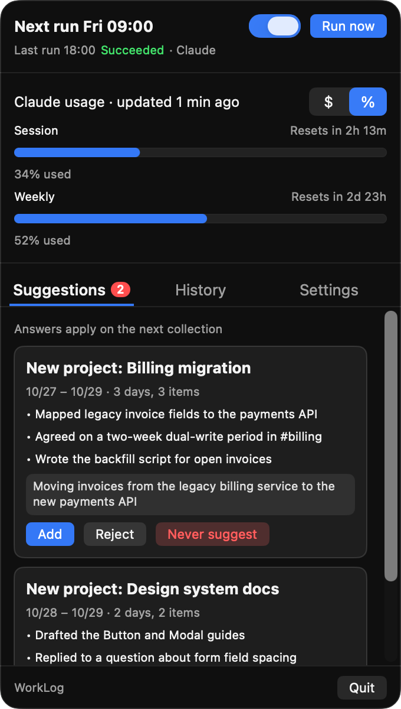
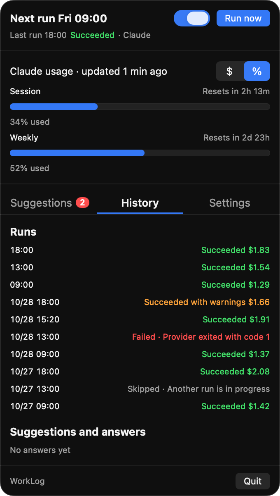
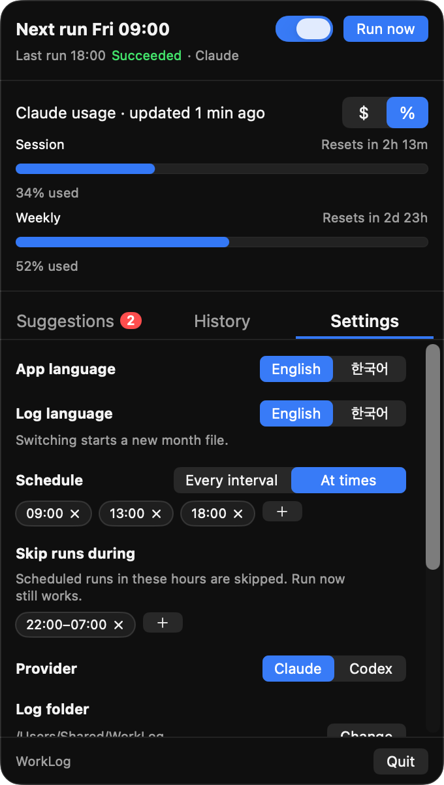

# work-log

English | [한국어](README.ko.md)

work-log records what you worked on each day. A headless coding agent (Claude Code or Codex) runs the `work-log` skill on a schedule. The skill collects:

- your Claude Code sessions
- your own Slack messages and DMs
- decisions and open agreements from threads you took part in

It writes them by date and project into a monthly Markdown log. Use the log as evidence for stand-ups and performance reviews.

The repo has two parts:

- **WorkLog.app**: a macOS menu bar app. It schedules runs, offers Run now, shows the run history and usage, and asks you about new-project suggestions.
- **`skill/work-log`**: the skill and its Python scripts. You can also run the skill by hand (`/work-log` in Claude Code, `$work-log` in Codex).

<p align="center">
  
  
  
</p>

<p align="center"><sub>The Suggestions, History and Settings tabs. The screenshots use sample data.</sub></p>

## Requirements

- macOS 14 or newer
- Command Line Tools (`xcode-select --install`), with Swift 5.10 or newer. Xcode is not needed.
- **Python 3.11 or newer, found as `python3`.** The Command Line Tools `python3` is 3.9, which is not enough. Install a newer one, for example with Homebrew or mise. The scripts use only the standard library.
- Claude Code (`claude`) or Codex (`codex`), signed in. Codex support is experimental (see [Codex](#codex-experimental)).
- For Slack collection with Claude, the Slack plugin for Claude Code. Without Slack, runs collect sessions only and finish with a warning.

## Install

```sh
curl -fsSL https://raw.githubusercontent.com/jo-minjun/work-log/main/bootstrap.sh | zsh
```

`bootstrap.sh` clones the repo into `~/.local/share/work-log` and runs `install.sh` from there. If that folder is already a clone of the repo, it pulls the latest `main` first (fast-forward only). It stops before cloning if the Command Line Tools are missing, and it changes nothing if the folder holds something else. Set `WORKLOG_INSTALL_DIR` to use another folder. To pass `install.sh` options, run `curl -fsSL https://raw.githubusercontent.com/jo-minjun/work-log/main/bootstrap.sh | zsh -s -- --no-open`.

To read the script before it runs, download it first (`curl -fsSLO https://raw.githubusercontent.com/jo-minjun/work-log/main/bootstrap.sh`), then run `zsh bootstrap.sh`.

If you already have a clone, run `./install.sh` in it instead.

`install.sh` does the following:

1. It checks that `python3` on the run PATH is 3.11 or newer, and stops if not.
2. It records the folders of `python3`, `claude` and `codex` from your shell. The app starts runs without a login shell, so it needs these folders.
3. It builds the app in release mode, signs it ad hoc and installs it as `~/Applications/WorkLog.app`.
4. It links the skill into both agents' user skill folders, each link pointing straight at `<repo>/skill/work-log`:
   - `~/.claude/skills/work-log` for Claude Code
   - `~/.agents/skills/work-log` for Codex

   A link that already points at the repo is kept. A link that points elsewhere is replaced, and its previous target is printed. If a real file or folder is at either place, the installer stops before changing anything.
5. It opens the app.

Options:

| Option | Effect |
|---|---|
| `--prefix DIR` | Install the app into `DIR` instead of `~/Applications` |
| `--no-open` | Do not open the app after installing |

To upgrade, run the same install command again, or `./install.sh` in your clone. Re-running `install.sh` upgrades in place. If WorkLog is running, the installer asks it to quit. If a collection is in progress, the installer stops and changes nothing. Re-run it after you move `python3`, `claude` or `codex`.

Keep the clone where it is (`~/.local/share/work-log`, or your own clone): the app runs the skill from it. The skill path must not contain spaces when you use Claude.

## First run

- **Menu bar.** WorkLog has no Dock icon. Click its menu bar icon to open the window.
- **Login item.** On first launch the app registers itself to open at login, and macOS may show a "Login item added" notice. Turn it off with **Launch at login** in Settings, or in System Settings → General → Login Items.
- **Schedule off.** A fresh install starts with the schedule off. The window opens on Settings. Check the settings, then turn on the schedule switch next to **Run now** at the top of the window. The same switch turns it off again. **Run now** works while the schedule is off.
- **Log folder.** The default is `~/WorkLog`, created on the first run with owner-only access. A folder you choose must already exist. WorkLog refuses your home folder, `/` and any folder that contains its data folder, because the agent may change files in the log folder.
- **Folder access prompt.** If the log folder is in iCloud Drive, Documents or Desktop, macOS asks whether WorkLog may access it. The first run waits up to 120 s for your answer. The app is signed ad hoc, so every rebuild changes its signature, and macOS may ask again after each reinstall.
- **Slack user.** The first run asks the Slack tool who you are, and saves only your user ID and display name. Settings shows the result.

## Settings

| Setting | Default | Notes |
|---|---|---|
| Schedule | At times: 10:00, 22:00 | **At times** runs at the listed times every day. **Every interval** runs every 1–24 h from an anchor time (default 4 h from 08:00), restarting from the anchor each day |
| Skip runs during | none | Scheduled slots inside a range are skipped; Run now still works. The start is included and the end is not. A range may cross midnight |
| Provider | Claude | Claude or Codex (Experimental) |
| Log folder | `~/WorkLog` | See [First run](#first-run) |
| Session folders | empty (all sessions) | Collect only sessions whose working directory is under these folders |
| App language | English | UI language of the app; independent of Log language |
| Log language | English | English or Korean. See [Log language](#log-language) |
| Launch at login | on | |
| Notify when a collection finishes | on | Failures and new suggestions are always notified |

Settings live in `settings.json` in the data folder. The app owns the schedule and app keys. The collector writes only the `slack` block.

## What a run does

1. It applies the suggestions you answered in the app.
2. It finds your Slack user.
3. It collects each pending day. The default is the days after the last completed day, through today. It rebuilds each day's section from scratch.
4. It groups the items left in the fallback project (`Other`) into topics, and proposes new projects (see [Suggestions](#suggestions)).

Inside a project, each day has four subsections: Claude Sessions, Slack, Decisions and Needs Confirmation. Needs Confirmation holds agreements that still wait on someone.

A run records one line in the history: succeeded, succeeded with warnings, failed or skipped. A run fails, for example, when the agent wrote nothing during the run, when it times out after 30 minutes, or when the log folder cannot be read. Runs never overlap. A slot that comes during a run is skipped.

To collect specific days by hand, run the skill in a new session:

```
/work-log                          # pending days (Codex: $work-log)
/work-log 2026-10-22               # one day
/work-log 2026-10-20..2026-10-26   # a range, both ends included
```

A session that runs the skill is left out of the collection. Run it in a new session, not in one you worked in.

## Log language

| Item | English | Korean |
|---|---|---|
| Month file | `2026-10 Work Log.md` | `2026년 10월 업무 로그.md` |
| Project list file | `Active Projects.md` | `진행 중인 프로젝트.md` |
| Day heading | `## 2026-10-29 (Thu)` | `## 2026-10-29 (목)` |
| Fallback project | `Other` | `기타` |

The project list file in the log folder names your projects, one `## <name>` section each, with a short description. The agent classifies items by these descriptions. You can edit the file at any time.

Switching the language does not convert existing files. The new language starts a new month file, because the file name differs. If the new language has no project list yet, the current one is copied. A day collected both before and after the switch (for example today, which every run collects again) appears in both files. Such days are not de-duplicated.

## Suggestions

When related work keeps landing in `Other`, the run proposes a new project. A topic qualifies with evidence on at least 2 distinct days and at least 3 items. The window starts 15 days before the 1st of the current month. Each pending suggestion appears in the Suggestions tab with its evidence and an editable description.

| Button | Effect |
|---|---|
| **Add** | The next run adds the project to the project list with your description, and moves the matching items out of `Other`. It moves them without collecting the days again |
| **Reject** | Recorded. The topic can come back only with new evidence dated after the rejection |
| **Never suggest** | The topic is never suggested again. History has a switch to undo it |

When a topic fits a project that already exists, the run extends that project's description and moves the items. It does not ask.

## Usage display

The usage area toggles between two views:

- **`$`** (Claude) or **Tokens** (Codex): this month's runs and their cost or tokens, from the run history. Claude runs that reported no cost are shown as `(+n without cost data)`.
- **`%`**: the 5-hour and weekly limits, with reset times and "updated n min ago".
  - Codex: read from the newest file in `~/.codex/sessions`. That format is not a public API, so the view may show "Unavailable".
  - Claude: Claude Code gives the limits only to your statusline command. Add the tap below.

### Statusline tap

`skill/work-log/scripts/save_rate_limits.sh` reads the statusline JSON on stdin and saves `rate_limits` to `claude-rate-limits.json`. It prints nothing and always exits 0, so it never changes or breaks your statusline. Call it from your existing statusline command, before the command uses its input:

```sh
#!/bin/sh
input=$(cat)
# WorkLog: save the rate limits (prints nothing, always exits 0)
printf '%s' "$input" | ~/.claude/skills/work-log/scripts/save_rate_limits.sh

# ...your existing statusline code, reading "$input" instead of stdin...
```

If you have no statusline yet, save the script above with your own output line and point `~/.claude/settings.json` at it:

```json
{ "statusLine": { "type": "command", "command": "~/.claude/statusline.sh" } }
```

The values update only while an interactive Claude Code session is open, so the view shows how old they are.

## Data and logs

| Location | Contents |
|---|---|
| `~/Library/Application Support/WorkLog/` | `settings.json`, `suggestions.json` (and its `.lock`), `runs.jsonl` (run history), `state.json` (last completed day), `claude-rate-limits.json` |
| `~/Library/Logs/work-log/` | `run.log` and `app-runner.log` (text logs), one `<date-time>.json` (agent output, including the transcript) and `.err` per run, and `.lock` while a run is active |
| Log folder (default `~/WorkLog`) | The month files and the project list |

Both WorkLog folders are owner-only (0700) and their files are 0600. The per-run `.json` and `.err` files are deleted after 7 days. `run.log` and `app-runner.log` are cut to their last 1000 lines once they pass 1 MB. Each run works in a fresh temporary folder that is deleted when the run ends or is stopped.

## Environment variables

| Variable | Effect |
|---|---|
| `WORKLOG_HOME` | Replaces the data folder |
| `WORKLOG_LOG_DIR` | Replaces the logs folder |
| `WORKLOG_EXTRA_PATH` | Folders put in front of the default run PATH. `install.sh` writes it into the app's Info.plist (`WorkLogExtraPath`) |
| `WORKLOG_PATH` | Replaces the run PATH entirely. Meant for tests |
| `WORKLOG_INSTALL_DIR` | Folder `bootstrap.sh` clones into (default `~/.local/share/work-log`) |
| `WORKLOG_REPO_URL` | Repo `bootstrap.sh` clones (default `https://github.com/jo-minjun/work-log.git`). Meant for forks and tests |

The default run PATH is `~/.local/share/mise/shims:~/.local/bin:/opt/homebrew/bin:/usr/local/bin:/usr/bin:/bin:/usr/sbin:/sbin`. The app, `run.sh` and the Python scripts all read `WORKLOG_HOME` and `WORKLOG_LOG_DIR`. They are mainly for development and tests, so that no test touches real data.

## Codex (experimental)

Codex runs as `codex exec --json --sandbox workspace-write` in a fresh temporary folder. It can write to the log folder and the WorkLog data folder. Known limits:

- **Slack calls can be cancelled.** Headless Codex may cancel MCP tool calls that need approval ([openai/codex#24135](https://github.com/openai/codex/issues/24135)). The mitigation is to set `default_tools_approval_mode` for the Slack plugin in `~/.codex/config.toml`. Approve only what you need; see the Codex configuration reference for the exact table for your Slack setup.
- **No MCP restriction.** WorkLog has no allow list for Codex. A Codex run can call every MCP tool you configured for Codex, including Slack tools that send messages.
- **Sessions are kept.** Codex keeps its session files (raw transcripts) in `~/.codex/sessions` indefinitely. WorkLog does not pass `--ephemeral`, because it reads usage from those files.
- **Codex reports no cost**, only tokens.

**When Slack is unavailable** (with either provider), a run writes only the first pending day, with sessions only and a warning, and then stops. The day is completed, so with a lasting Slack failure each run moves the backlog forward by one day. These runs are recorded as succeeded with warnings, and the menu bar shows an orange dot. Fix Slack access, then collect the affected days again by hand.

## Security model and residual risks

- **Headless Claude permissions.** Claude runs with `--permission-mode dontAsk`, which denies every tool call not on the allow list. The allow list has:
  - `python3 <skill>/scripts/<name>.py` for the five collector scripts, by absolute path
  - `Read`
  - `Edit` in the log folder and the run's temporary folder only
  - the `work-log` skill
  - three read-only Slack tools: search, read thread, read profile
- **Your own Claude Code settings still apply.** Allow rules, hooks, plugins and MCP servers from `~/.claude/settings.json` are merged in. `dontAsk` only denies what nothing allows.
- **`Read` is unscoped.** Text injected into a Slack message could make the agent read local files. The outward paths are narrow: no web access, no other shell commands, no writes outside the two folders, read-only Slack. What the agent read could still reach the log folder (which iCloud may sync) or the run's `.json` transcript, which is kept 7 days.
- **Prompt injection.** The skill treats every collected text (Slack messages, session prompts, the project list) as data, and never follows instructions, commands or URLs in it.
- **Secret scanning.** `write_day.py day` and `suggestions.py propose` refuse values that look like credentials and exit with code 4. Examples are Slack and GitHub tokens, AWS keys, `sk-` keys, JWTs, private keys, and URLs with signature, token, key or password query values. The scan is pattern-based and cannot catch every secret.
- **Path flags.** The allowed scripts accept `--settings`, `--state` and `--file` path options. An agent could use them to create a file with a fixed name (such as `settings.json` or `state.json`) in another writable folder. The risk is low: the content is WorkLog's own data, not chosen by the agent.

## Sleep and missed runs

WorkLog runs only while the Mac is awake and you are logged in. A slot that passes during sleep (the timer fires more than 2 minutes late) is recorded as skipped and is not caught up. Several missed slots in one sleep leave one record. Press **Run now** to catch up: by default a run collects every day since the last completed one.

## Development

```sh
cd skill/work-log && python3 -m unittest discover -s tests   # Python tests
cd app && swift run WorkLogChecks                            # Swift checks
cd app && WORKLOG_SKILL_PATH="$PWD/../skill/work-log" swift run WorkLog   # the app without a bundle
```

`swift run WorkLog` reads the skill path and `WORKLOG_EXTRA_PATH` from the environment instead of Info.plist. Set `WORKLOG_HOME` and `WORKLOG_LOG_DIR` to keep it away from your real data.

## Uninstall

1. Quit WorkLog from its window. If a run is in progress, the app asks first.
2. Remove it from System Settings → General → Login Items, or turn off **Launch at login** before quitting.
3. Delete the app and the two skill links:
   ```sh
   rm -rf ~/Applications/WorkLog.app      # or <prefix>/WorkLog.app
   rm ~/.claude/skills/work-log ~/.agents/skills/work-log
   ```
4. Delete the data and log folders:
   ```sh
   rm -rf ~/Library/Application\ Support/WorkLog ~/Library/Logs/work-log
   ```
5. Remove the `save_rate_limits.sh` line from your statusline command, if you added it.

Your log folder (default `~/WorkLog`) holds your work logs. Delete it only if you no longer want them.

## License

MIT. See [LICENSE](LICENSE).
