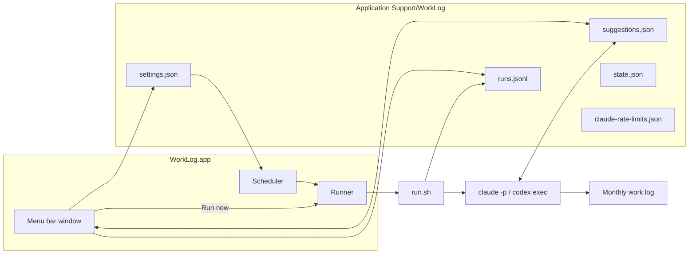
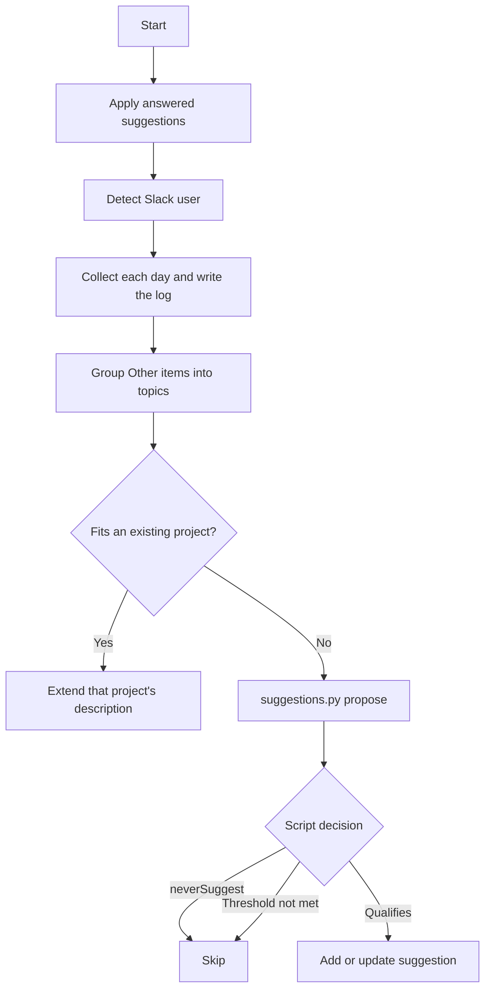

# WorkLog App Design

Date: 2026-10-29
Status: Implemented. This is the design the first version was built from. Where it and the README differ, the README describes the current behaviour.

## 1. Goal

Turn the `work-log` skill into a public, self-contained macOS tool. A menu bar app keeps running, starts the headless collector at the times the user chooses, and shows suggestions that come out of a collection so the user can answer them in the app.

The collector itself stays what it is today: a headless agent run (`claude -p` or `codex exec`) of the `work-log` skill. The skill gathers the day's Claude Code sessions, the user's Slack messages, and decisions from threads the user took part in. It writes them to a monthly Markdown log.

## 2. Scope

In scope:
- A menu bar app (SwiftUI) with three tabs: Suggestions, History and Settings.
- The app's own scheduler, which replaces the launchd agent.
- Settings stored in one JSON file. `config.toml` is removed.
- New-project suggestions that the user answers in the app and that the next collection applies.
- A Claude/Codex provider choice. Codex is marked "Experimental".
- A log language setting: English (default) or Korean.
- A "Needs confirmation" category in the log.
- A usage display that toggles between `$` and `%`.
- A new public GitHub repository (personal account). The skill and app are generalized: no personal names, company channels or IDs.

Out of scope:
- Conversations about a suggestion (asking follow-up questions about it in the app).
- Weekday selection in the schedule.
- Per-model weekly usage (for example Fable). No official source exposes it.
- Prebuilt, notarized releases. Users build from source.

## 3. Repository

Name: `work-log`. Public, personal GitHub account, MIT license. English only (README, SKILL.md, code comments, app UI).

```
work-log/
├── app/                    Swift package: menu bar app + tests
├── skill/work-log/         SKILL.md, scripts/, tests/
├── fixtures/               sample settings.json, suggestions.json, runs.jsonl
├── install.sh              build app, install to ~/Applications, link skill
├── bootstrap.sh            clone or update into ~/.local/share/work-log, then run install.sh
└── docs/                   this design
```

- `install.sh` creates two symlinks to `<repo>/skill/work-log`: `~/.claude/skills/work-log` for Claude Code and `~/.agents/skills/work-log` for Codex.
- The first commit is a clean import. The history of the private setup the skill came from is not carried over, because it contains personal data.
- Before the first push, the whole tree is searched for: real names, company Slack domains and org names, Slack user IDs and home paths. Any match blocks the push.

## 4. Components



### 4.1 App

| Part | Responsibility |
|---|---|
| Menu bar item | Icon. A number badge counts pending suggestions; a red mark shows that the last run failed. |
| Window | A status area at the top: next run, the schedule on/off switch, Run now, last run result. Under it, the usage area with the `$`/`%` toggle. Then three tabs: Suggestions, History and Settings. The status and usage areas show on every tab, and the window keeps one fixed height, because a menu bar window that resizes is re-anchored to its status item, which a menu bar manager may have moved off screen. |
| SettingsStore | Reads and writes `settings.json` atomically. |
| Scheduler | Pure function `nextRun(settings, now, calendar) -> Date?` plus one timer. |
| Runner | Runs `run.sh`, one run at a time. Tracks the running state. |
| SuggestionStore | Reads `suggestions.json`. Writes only the answer fields, under the lock. Watches the file for changes. |
| RunLog | Reads `runs.jsonl` for History and the monthly cost. |
| UsageReader | Reads Claude usage from `claude-rate-limits.json` and Codex usage from the newest `~/.codex/sessions/**/*.jsonl`. |
| Notifier | Posts "Collection finished" (with cost or tokens; can be turned off in Settings), "Collection failed" and "n new suggestions". Skipped slots post nothing. |
| LoginItem | Registers the app with `SMAppService.mainApp` on first launch. Settings has a toggle for it. |

The window layout follows the approved mockup (v4):
- **Status area.** "Next run 22:00" (or "Schedule off"), the schedule switch, the Run now button, and "Last run 14:46 Succeeded · Claude". The last-run line shows no cost.
- **Usage area.** The title row holds the `$`/`%` toggle, placed apart from Run now.
  - `%` shows the session (5 h) and weekly bars, the reset times and "updated n min ago".
  - `$` shows "This month: n runs, $x". With Codex, the toggle reads `Tokens`/`%`.
- **Suggestions tab.** Each pending suggestion is a card with its evidence and an editable description draft. It has three buttons: Add, Reject, Never suggest.
- **History tab.** Shows the run history (time, result, cost or tokens) and past suggestions with their answers. Each past suggestion has a "Never suggest" switch.
- **Settings tab.**
  - App language: English (default) or Korean. Independent of the log language.
  - Log language: English or Korean.
  - Schedule mode: "Every interval" or "At times".
  - Times list with `+`. Interval hours and anchor time.
  - "Skip runs during" (quiet ranges) list with `+`.
  - Provider: Claude or Codex (Experimental).
  - Log folder: a folder picker.
  - Session folders list with `+`. An empty list means all sessions.
  - Slack status line.
  - Launch at login toggle.
  - "Notify when a collection finishes" toggle.

### 4.2 Skill

- `scripts/settings.py` replaces `config.py`. It reads `settings.json` and applies defaults when the file is missing. A broken file is an error (exit 2). Its `set-slack` subcommand writes only the `slack` fields.
- `scripts/suggestions.py` (new) owns all reads and writes of `suggestions.json`. It has four subcommands:
  - `list`: all suggestions, including rejected ones, for topic matching.
  - `answered`: suggestions waiting to be applied.
  - `mark-applied --id --result`: records the result of applying a suggestion.
  - `propose --json`: adds or updates a suggestion; the script decides whether it qualifies.
- `scripts/write_day.py` gains the `needs_confirmation` source. Section names, the day heading, the weekday and the file name follow the log language. The `candidates` subcommand and the `## 새 프로젝트 후보` section are removed.
- `scripts/run.sh` (renamed from `run_scheduled.sh`) runs the selected provider and appends a line to `runs.jsonl`. It no longer posts notifications.
- SKILL.md:
  - Rewritten in English and generalized.
  - Tool names are provider-neutral ("the Slack search tool").
  - It describes the new suggestion flow, Slack self-detection and the log language.

## 5. Data files

All files live in `~/Library/Application Support/WorkLog/`. Writers replace a file atomically (write a temp file, then rename).

### 5.1 settings.json

```json
{
  "version": 1,
  "schedule": {
    "mode": "times",
    "times": ["10:00", "22:00"],
    "interval": {"hours": 4, "anchor": "08:00"},
    "quietRanges": [{"start": "00:00", "end": "08:00"}]
  },
  "provider": "claude",
  "logFolder": "~",
  "logLanguage": "en",
  "sessionFolders": [],
  "launchAtLogin": true,
  "notifyOnSuccess": true,
  "slack": {"userId": null, "displayName": null, "checkedAt": null}
}
```

Fields and defaults:

| Field | Default | Notes |
|---|---|---|
| `schedule.mode` | `times` | `times` or `interval`. The value for the other mode is kept, so switching back restores it. |
| `schedule.times` | `["10:00", "22:00"]` | |
| `schedule.interval` | `{"hours": 4, "anchor": "08:00"}` | |
| `schedule.quietRanges` | `[]` | |
| `provider` | `claude` | `claude` or `codex` |
| `logFolder` | `~/WorkLog` | The home folder itself, `/`, and folders containing the data folder are refused |
| `logLanguage` | `en` | `en` or `ko` |
| `appLanguage` | `en` | `en` or `ko`; UI only, the collector ignores it |
| `sessionFolders` | `[]` | `[]` means all Claude Code sessions |
| `launchAtLogin` | `true` | |
| `notifyOnSuccess` | `true` | Post "Collection finished" after a successful run |
| `scheduleEnabled` | `false` | A fresh install starts with the schedule off; the switch next to Run now turns it on |
| `slack.*` | `null` | Written only by the collector |

The time zone is the system time zone. There is no setting for it.

### 5.2 suggestions.json

```json
{
  "version": 1,
  "suggestions": [
    {
      "id": "uuid",
      "type": "new_project",
      "name": "Work automation",
      "description": "Draft description",
      "evidence": [{"date": "2026-10-23", "source": "Claude session", "line": "..."}],
      "status": "pending",
      "neverSuggest": false,
      "createdAt": "ISO-8601",
      "updatedAt": "ISO-8601",
      "pendingAnswer": null,
      "history": [
        {"answer": "reject", "answeredAt": "ISO-8601", "appliedAt": "ISO-8601", "result": "Recorded rejection"}
      ]
    }
  ]
}
```

- `status`: `pending` → `answered` → `applied`.
- `pendingAnswer` is `{"answer": "accept" | "reject", "answeredAt", "description"}` while the status is `answered`. When `mark-applied` runs, it moves into `history` along with `appliedAt` and `result`.
- What each app button writes:
  - Add: `accept`. The description the user edited goes into `pendingAnswer.description`.
  - Reject: `reject`.
  - Never suggest: `reject` and `neverSuggest: true`.
- The History switch changes only `neverSuggest`.
- Who writes which fields:
  - The app writes `status` (`pending` → `answered`), `pendingAnswer` and `neverSuggest`.
  - `suggestions.py` writes everything else.
- Both writers take an exclusive `flock` on `suggestions.json.lock`, then read, modify and replace the file. The lock wait is at most 10 s.

### 5.3 runs.jsonl

One line per run, appended by `run.sh` and, for a few cases, the app:

```json
{"startedAt": "ISO-8601", "endedAt": "ISO-8601", "trigger": "schedule|manual", "provider": "claude", "result": "succeeded|failed|skipped", "reason": "text or null", "costUsd": 0.97, "tokens": null, "logPath": "..."}
```

- `run.sh` writes `skipped` with reason "Another run is in progress" when the run lock is held.
- The app writes `skipped` lines for a missed slot and for a slot that came while its own run was in progress, and `failed` lines for a run that could not start or was stopped on quit.
- Both writers append one line with a single `O_APPEND` write, so concurrent appends do not interleave.

### 5.4 state.json

Same content as today (`lastCompletedDate`, `lastWrittenAt`). It moves here from the skill folder.

### 5.5 claude-rate-limits.json

Written by the statusline tap (§9). It stores `five_hour` and `seven_day` (`used_percentage`, `resets_at`) and `updatedAt`.

## 6. Scheduling

- **Every interval.**
  - Slots start at `anchor` each day, then repeat every `hours` (an integer from 1 to 24). The last slot is the one before the next day's anchor.
  - The sequence restarts from the anchor every day, even when `hours` does not divide 24. For example, 5 h from 08:00 gives 08, 13, 18, 23, then 03 the next day, then 08 again.
- **At times.** The listed times, every day.
- **Skip runs during (quiet ranges).**
  - A slot inside any range is dropped. The start is inclusive and the end is exclusive.
  - A range may cross midnight (23:00–07:00).
  - `start == end` is rejected in the UI.
- **No slot.** `nextRun` looks 48 h ahead. If it finds no slot, it returns `nil` and the window shows "No run scheduled".
- **Timer.** One timer is set for the next slot.
- **Recompute triggers.**
  - Settings change.
  - Wake from sleep (`NSWorkspace.didWakeNotification`).
  - Clock or time zone change (`NSSystemClockDidChange`, `NSSystemTimeZoneDidChange`).
  - End of a run.
- **Missed slots.**
  - If the timer fires more than 2 minutes after its slot, the slot counts as missed. A missed slot is skipped and recorded as "Skipped: slot passed".
  - Missed slots are never caught up. The user can press Run now.
- **Overlap.** A slot that arrives during a run is skipped and recorded as "Skipped: previous run in progress".
  - Run now is disabled while a run is in progress. Its label changes to "Running…".
- **Quit while running.** The app asks for confirmation first. If the user quits, the app terminates the run's process group and removes the lock.

## 7. Run pipeline

`run.sh` keeps today's safeguards:
- the PATH setup
- the log folder access check (120 s)
- the lock with stale cleanup (60 min)
- the 30-minute timeout
- success detection by `lastWrittenAt >= startedAt`

What it adds:
- It checks that the provider binary exists. If not, it records a failed run with the reason "Provider not found".
- It runs the provider:
  - Claude: `claude -p "/work-log" --allowedTools <list> --no-session-persistence --output-format json`.
  - Codex: `codex exec --json --sandbox workspace-write --add-dir <logFolder> --add-dir <Application Support/WorkLog> --skip-git-repo-check '$work-log'`. The skill name is in single quotes so the shell does not expand `$work`.
- It appends the run to `runs.jsonl`.
  - Claude: `costUsd` comes from `total_cost_usd`.
  - Codex: `tokens` is the sum from the `turn.completed` events. Codex reports no cost.

The app passes `trigger` to the script through an environment variable.

## 8. Collection flow (skill)



1. **Apply answered suggestions.**
   - `accept`:
     - Add the name and description to the project list file. The app's Add button is the user's approval.
     - Recollect the days from the first to the last evidence date, so the items move out of Other.
     - Then call `mark-applied`.
     - If the recollection fails, the suggestion stays `answered` and is retried next run.
   - `reject`: call `mark-applied` with "Recorded rejection".
2. **Detect the Slack user.**
   - Call the Slack profile tool with no user ID. It returns the current user.
   - Save only `userId`, `displayName` and `checkedAt` to `settings.json` through `settings.py set-slack`.
   - If this fails, collect Claude sessions only and write a warning into the day section.
3. **Collect each day.** Same as today, with two changes:
   - Unconfirmed agreements go to the `needs_confirmation` source. Example: a message that still asks for a check the next day.
   - Writing follows the log language.
4. **Suggestions.** `propose` decides whether a topic qualifies:
   - New topic: evidence on at least 2 distinct days and at least 3 items. The window is the current month plus the last 15 days of the previous month.
   - Previously rejected topic: count only evidence dated after the last rejection, with the same thresholds.
   - `neverSuggest`: never.
   - Pending suggestion for the same topic: update its evidence. No new record is created.

   Topic matching across different names is the agent's job. It gets `list` first and passes an existing `id` when the topic matches one.
5. **Interactive runs** (`/work-log` in a terminal) follow the same flow. They end with "Answer suggestions in the WorkLog app" instead of asking in chat.

## 9. Usage display

- **Claude `%`.**
  - Source: the statusline input `rate_limits` (`five_hour`, `seven_day`). This is the only documented source.
  - The repo ships `skill/work-log/scripts/save_rate_limits.sh`. It reads the statusline JSON on stdin and writes `claude-rate-limits.json`.
  - The user's existing statusline command calls it. The change to the user's statusline script is shown and approved separately during installation.
  - The value only updates while interactive Claude Code sessions run. The UI therefore shows "updated n min ago".
  - Per-run `%` is not shown.
- **Codex `%`.**
  - Source: the last `rate_limits` in `token_count` events of the newest `~/.codex/sessions/YYYY/MM/DD/*.jsonl` (primary = 5 h, secondary = weekly).
  - This format is not a public API. If parsing fails, the UI shows "Unavailable".
- **`$`.** "This month: n runs, $x" from `runs.jsonl`. For Codex: tokens.

## 10. Log language

| Item | `en` | `ko` |
|---|---|---|
| Month file | `2026-10 Work Log.md` | `2026년 10월 업무 로그.md` |
| Project list file | `Active Projects.md` | `진행 중인 프로젝트.md` |
| Day heading | `## 2026-10-29 (Thu)` | `## 2026-10-29 (목)` |
| Subsections | Claude Sessions / Slack / Decisions / Needs Confirmation | Claude 세션 / Slack / 결정 / 확인 필요 |
| Fallback project | `Other` | `기타` |
| Summaries | English | Korean |

- Frontmatter keeps the same keys in both languages. Only the title and the tags change.
- Changing the language does not convert existing files. The new language starts a new month file, because the file name differs.

## 11. Error handling

| Case | Behavior |
|---|---|
| `settings.json` missing | Use the defaults |
| `settings.json` broken | Collector: run fails (exit 2) and is recorded. App: shows an error with "Back up and reset" |
| `suggestions.json` broken | Neither side writes it. Collector skips the suggestion step with a warning. App: shows an error with "Back up and reset" |
| Lock wait over 10 s | Collector skips the suggestion step with a warning. App retries the save |
| Log folder unreachable | The access check fails. The run is recorded and the app shows "Log folder unreachable" |
| Provider binary missing | Recorded as failed: "Provider not found" |
| Slack auth failure or Codex MCP call cancelled | Claude sessions only, plus a warning in the day section |
| Timeout (30 min) | The run is killed and recorded as "Timed out" |
| Usage file missing or stale | "No usage data" or "updated n h ago" |
| Stale lock after a crash | Cleared after 60 min (as today) |

## 12. Testing

- **Python** (`unittest`, extending the current 64 tests). Each new test must fail before the change.
  - `settings.py`: a missing file gives the defaults; a broken file gives exit 2; `set-slack` writes only the slack fields.
  - `suggestions.py`:
    - A new topic needs at least 2 days and at least 3 items.
    - A rejected topic counts only evidence after the rejection.
    - `neverSuggest` is skipped.
    - A pending topic is updated, not duplicated.
    - `mark-applied` moves `pendingAnswer` into `history`.
    - A lock timeout gives exit 2.
  - `write_day.py`:
    - The `needs_confirmation` subsection comes last.
    - Both languages render their headings, file names and weekday.
  - `run.sh` result parsing: runs.jsonl lines for Claude JSON output and for Codex `--json` events (fixture files).
- **Swift.**
  - `nextRun`:
    - Interval with a daily restart.
    - Quiet hours: start inclusive, end exclusive, ranges that cross midnight.
    - No slot within 48 h.
  - Missed-slot detection (more than 2 min late).
  - `suggestions.json` answer writes keep the other fields unchanged.
  - Usage parsing for both sources.
  - Whether XCTest or swift-testing runs with Command Line Tools only is checked first. If neither does, a small test executable with assertions is used instead.
- **Shared fixtures.** Both test suites read `fixtures/` (settings, suggestions, runs). A schema change on one side breaks the other side's tests.
- **Manual checks.**
  - Install and grant iCloud access.
  - Run now.
  - Answer a suggestion and see it applied on the next run.
  - Log in again and check that the app launches.
  - Switch the log language.

## 13. Risks and open points

- **Codex headless MCP calls may be cancelled** for lack of approval (openai/codex#24135). Mitigation: document `default_tools_approval_mode` for the Slack plugin, and fall back to the Slack-failure path.
- **Codex `rate_limits` field names** are not verified on this machine, which has no Codex session files yet.
- **Statusline updates** may not happen in `-p` runs. That is why Claude `%` shows the current usage, not the usage per run.
- **Ad-hoc signing.** Rebuilding the app changes its signature. macOS then asks again for iCloud Drive access.
